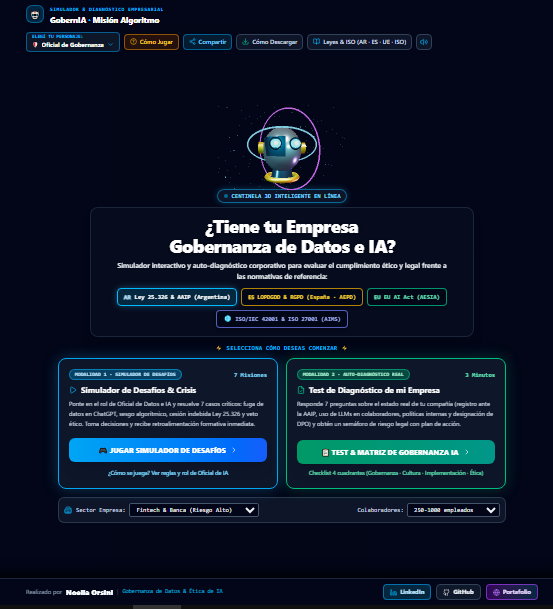

# GobernIA: Misión Algoritmo 🤖⚖️

> **Simulador Ejecutivo de Gobernanza de Datos, Ética de Inteligencia Artificial y Cumplimiento Regulatorio**  
> Basado en la **Ley 25.326** y **Res. 161/2023 (Guía de IA Responsable)** de Argentina, la **LOPDGDD** (Ley Orgánica 3/2018) de España, el **RGPD** de la Unión Europea y el **EU AI Act**.

🎮 **Jugar en línea ahora**: [Acceder a GobernIA: Misión Algoritmo](https://ais-pre-dcb3fhcx3tpdfq3qmhd33j-417411161966.us-west2.run.app)

---

## 📸 Pantalla de Inicio



*(Para mostrar la imagen de portada, sube tu captura a la carpeta `assets/` con el nombre `gobernIA.png` o `gobernIA.jpg`)*

---

## 🎯 Acerca del Proyecto

**GobernIA: Misión Algoritmo** es una plataforma interactiva y pedagógica orientada a directores, delegados de protección de datos (DPO), compliance officers y líderes tecnológicos. A través de **7 Desafíos Corporativos Críticos**, el usuario toma decisiones estratégicas frente a dilemas de gobernanza de datos y despliegue de modelos de IA, midiendo su impacto en tiempo real sobre tres dimensiones maestras:

1. **Cumplimiento Legal**: Ley 25.326, RGPD, LOPDGDD, sanciones de AAIP y AEPD.
2. **Ética de IA**: Transparencia algorítmica, mitigación de sesgos, paridad y supervisión humana.
3. **Eficiencia Operativa**: Viabilidad del negocio, costos de gobernanza y velocidad de innovación.

---

## 🏢 Escala de Madurez de Gobernanza (CMMI / DAMA-DMBOK)

El sistema calcula el nivel institucional de la organización:

- 🔴 **Nivel 1: Inicial / Caótico (<35 pts)**: Gobernanza inexistente, Shadow AI descontrolado, riesgo de multas punitivas inminentes.
- 🟠 **Nivel 2: Emergente / En Silos (35-54 pts)**: Punto de partida (50 pts base). Iniciativas aisladas sin estándar corporativo.
- 🟡 **Nivel 3: Definido / Institucionalizado (55-74 pts)**: Políticas estandarizadas, catálogo funcional y comités activos.
- 🟢 **Nivel 4: Gestionado Cuantitativamente (75-87 pts)**: Telemetría continua, MLOps maduro y preparación para ISO/IEC 42001.
- 🔵 **Nivel 5: Optimizado / Líder de Industria (88-100 pts)**: Gobernanza ágil y confianza ética como principal ventaja competitiva.

---

## 🚀 Tecnologías

- **Framework**: React 18 + Vite + TypeScript
- **Estilos**: Tailwind CSS
- **Iconografía**: Lucide React
- **Audio Sintetizado**: Web Audio API (efectos de sonido adaptativos)
- **Persistencia**: LocalStorage (perfiles, historial y métricas)

---

## 🛠️ Instalación y Ejecución Local

```bash
# 1. Clonar el repositorio
git clone https://github.com/NoeliaOrsini/gobernIA-ai-governance-simulator.git
cd gobernIA-ai-governance-simulator

# 2. Instalar dependencias
npm install --legacy-peer-deps

# 3. Iniciar servidor de desarrollo
npm run dev

# 4. Compilar para producción
npm run build
```

---

## 🌐 Despliegue en GitHub Pages

El proyecto ya cuenta con las rutas relativas (`base: './'`) preparadas para correr en GitHub Pages sin configuración compleja:

1. En tu repositorio en GitHub, ve a **Settings** ➡️ **Pages**.
2. En **Build and deployment** ➡️ **Source**, selecciona **GitHub Actions**.
3. El flujo automatizado compilará el juego y estará disponible en:  
   `https://NoeliaOrsini.github.io/gobernIA-ai-governance-simulator/`

---

## 📜 Créditos y Autoría

Desarrollado y conceptualizado por **Noelia Orsini**.  
Orientado a la difusión y aplicación práctica de la gobernanza de datos y la inteligencia artificial responsable en Iberoamérica.
